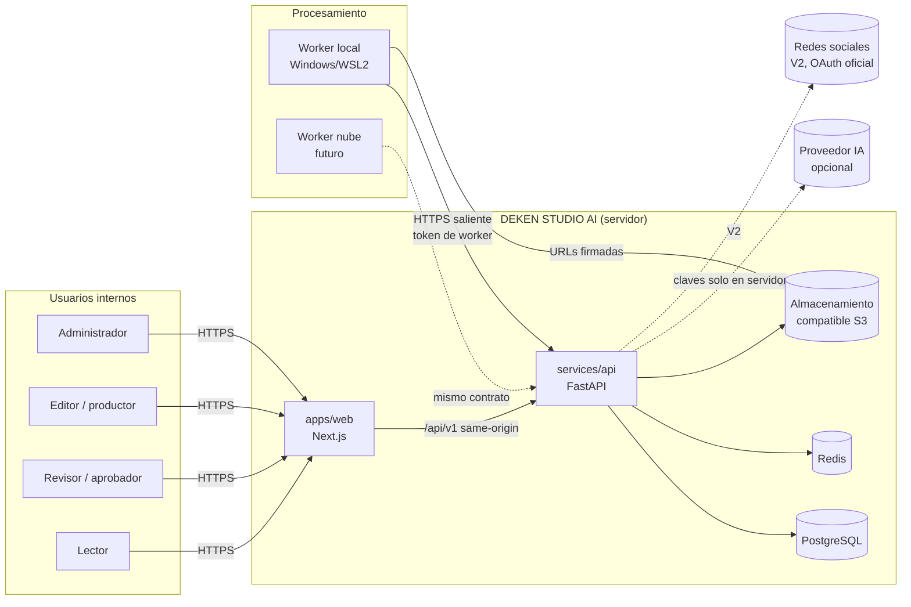
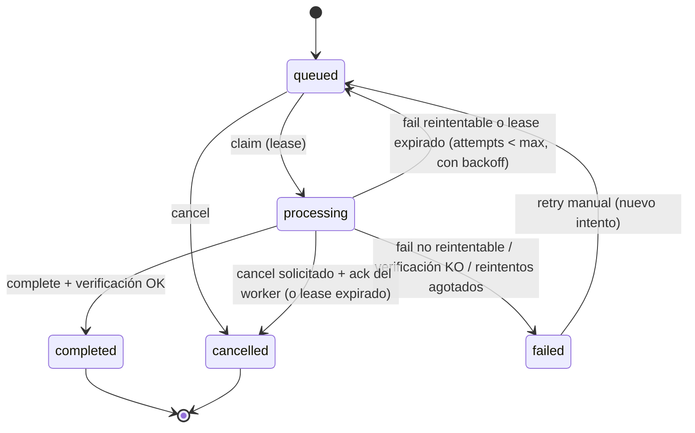
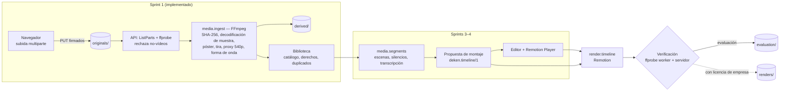

# DEKEN STUDIO AI — Arquitectura

> Estado: **vigente para V1**. Documento vivo: cualquier cambio de arquitectura se
> registra aquí y, si es una decisión relevante, en `docs/adr/`.
>
> Documentos relacionados:
> [IMPLEMENTATION_PLAN.md](IMPLEMENTATION_PLAN.md) ·
> [docs/ENVIRONMENT_REVIEW.md](docs/ENVIRONMENT_REVIEW.md) ·
> [docs/DATA_MODEL.md](docs/DATA_MODEL.md) ·
> [docs/CONTRACTS.md](docs/CONTRACTS.md) ·
> [docs/DEPENDENCIES_AND_CREDENTIALS.md](docs/DEPENDENCIES_AND_CREDENTIALS.md) ·
> [docs/SECURITY.md](docs/SECURITY.md)

## 1. Propósito

DEKEN STUDIO AI es una plataforma **privada** de Grupo Deken (fabricante de ventanas y
puertas de PVC Schüco para profesionales, Santiponce, Sevilla) que une en un mismo
sistema:

1. Producción audiovisual automática a partir de grabaciones reales de DEKEN.
2. Edición manual sobre una línea de tiempo estructurada.
3. Dirección creativa asistida por IA, anclada en una base de conocimiento verificada.
4. Planificación de campañas y calendario editorial.
5. Gestión de identidad de marca.
6. (V2) Publicación en redes vía APIs oficiales, analítica y leads.

### Principios no negociables

| Principio | Consecuencia técnica |
|---|---|
| Nada simulado | Un trabajo solo es `completed` si su salida existe en el almacenamiento y supera la verificación (ffprobe en servidor). No hay datos de ejemplo en producción. |
| Originales intocables | Los originales se guardan con clave generada por el servidor, nunca se sobrescriben ni se procesan in situ; todo derivado es un objeto nuevo. |
| Afirmaciones verificadas | La IA solo puede afirmar datos técnicos presentes en la base de conocimiento, con cita a la fuente. Sin IA configurada, la plataforma funciona en modo manual y lo dice. |
| Aprobación humana | Ningún contenido pasa a "publicable" sin aprobación de un usuario con rol `reviewer` o `admin`. La publicación automática no existe en V1. |
| Público profesional | Mensajes orientados a instaladores, distribuidores, constructoras y carpinterías. DEKEN no se posiciona como instalador para particulares. |
| Honestidad de la interfaz | Las secciones no implementadas aparecen deshabilitadas con su sprint; nunca como operativas. |

## 2. Contexto



El navegador **solo** habla con `apps/web` y con `/api/v1` (mismo origen) y descarga
o sube ficheros mediante URLs firmadas de corta duración. Ninguna credencial de
proveedor llega al navegador.

## 3. Separación de responsabilidades

La brief exige separar estrictamente seis capas. Así se materializan:

| Capa | Dónde vive | Regla |
|---|---|---|
| Interfaz | `apps/web` | Sin lógica de negocio: renderiza, valida formularios para UX y llama a la API tipada. Nunca decide permisos (solo oculta lo que la API denegaría). |
| Lógica de negocio | `services/api/src/deken_api/services/` | Casos de uso puros sobre la sesión de BD y puertos (storage, cola, IA). No conoce HTTP. |
| Servicios de IA | `services/api/src/deken_api/ai/` (Sprint 2) | Puerto `AIProvider` con implementaciones intercambiables; recibe contexto de la base de conocimiento y devuelve contenido con citas. |
| Procesamiento audiovisual | `workers/*` + `packages/video-compositions` | Procesos separados que solo hablan con la API por HTTPS. Composición y render final con **Remotion**; análisis, proxys y verificación con **FFmpeg** (listas de argumentos, nunca shell). Ver §10 y ADR 0005. |
| Persistencia | `services/api/src/deken_api/db/` + `infra/migrations/` | SQLAlchemy 2 (async) + Alembic. Solo la API toca PostgreSQL. |
| Integraciones externas | `services/api/src/deken_api/integrations/` | Storage S3, Redis, ffprobe, (V2) redes sociales. Cada una tras una interfaz con comprobación de salud. |

Las rutas HTTP (`api/v1/*`) son adaptadores finos: validan con Pydantic, comprueban
permisos y delegan en `services/`.

## 4. Estructura del monorepo

```
apps/web/                 Next.js (App Router) + React + TypeScript estricto
services/api/             FastAPI: API v1, auth, RBAC, auditoría, trabajos, storage
workers/runtime/          SDK común de workers (cliente HTTP, bucle, sandbox de procesos)
workers/render/           Handlers de render: autotest FFmpeg y Remotion (evaluación, timeline)
workers/render/remotion/  Renderer Node de Remotion (CLI con eventos JSON, servidor local de entradas)
workers/analysis/         Handlers de análisis: ingesta (hash, póster, tira, proxy, forma de onda);
                          segmentos y transcripción en Sprint 3
packages/video-compositions/  Composiciones Remotion, esquema deken.timeline/1 (zod → JSON Schema),
                          reglas semánticas, geometría sin deformación y catálogo de plantillas
packages/shared/python/   Contratos Python compartidos (contrato de trabajos v1, límites de medios)
packages/shared/ts/       Tipos TS generados desde OpenAPI + constantes compartidas
packages/shared/openapi/  openapi.json generado (versionado en git, comprobado en CI)
packages/brand/           Tokens de marca (CSS/TS), tipografías, reglas de uso
infra/                    Docker Compose, Dockerfiles, migraciones Alembic, scripts de backup
docs/                     Arquitectura detallada, contratos, despliegue, manuales
```

Herramientas: **uv** (workspace Python) y **pnpm** (workspace JS). Un único `Makefile`
en la raíz orquesta tareas comunes.

## 5. Stack y justificación

| Pieza | Elección | Motivo |
|---|---|---|
| Web | Next.js 16 + React 19 + TS 5.9 estricto | Requerido por la brief. App Router, rewrites a la API en desarrollo. |
| Estado de servidor en web | TanStack Query 5 | Caché, reintentos y estados de carga/error explícitos. |
| Cliente API | `openapi-fetch` + tipos generados por `openapi-typescript` | Un único origen de verdad (OpenAPI de FastAPI); CI falla si los tipos no están al día. |
| API | FastAPI + Pydantic 2 + SQLAlchemy 2.x async + asyncpg | Tipado, OpenAPI automática, I/O asíncrona (long-poll de workers). |
| Migraciones | Alembic, en `infra/migrations` | Versionadas, reversibles, comprobadas en CI (`alembic check`). |
| Contraseñas | argon2id (`argon2-cffi`) | Recomendación OWASP. |
| Sesiones | Cookie opaca + tabla `sessions` (no JWT) | Revocación inmediata (logout, desactivación de usuario), sin refresh tokens en el navegador. |
| Cola | PostgreSQL como fuente de verdad + Redis (Valkey 8, BSD) como señal | Estado durable y auditable; `SKIP LOCKED` para reparto; Redis despierta a los workers en long-poll y limita intentos de login. Si Redis cae, los workers siguen funcionando por sondeo. |
| Almacenamiento | S3 (boto3). Dev: **SeaweedFS** (Apache-2.0) | Compatible S3, licencia permisiva. MinIO descartado por cambio de distribución/licencia (ver `docs/ENVIRONMENT_REVIEW.md`). Producción: cualquier S3 (AWS, Cloudflare R2, Wasabi, SeaweedFS propio). |
| Composición y render final | **Remotion 4.0.531** (React) + Chrome Headless Shell en el worker | Motor principal: títulos, transiciones, subtítulos, marca, plantillas, multicapa y previsualización (Remotion Player) con el mismo código. **Solo evaluación** hasta regularizar la licencia de empresa (ADR 0005). |
| Vídeo auxiliar | FFmpeg/ffprobe 7.x (CLI) | Análisis, metadatos, miniaturas, proxys, formas de onda, normalización y verificación de salidas (worker y servidor). |
| Transcripción | faster-whisper (MIT) en el worker local | Privacidad (audio no sale del equipo), sin coste por minuto. Sprint 1/4. |
| Logs | structlog JSON + `X-Request-ID` | Correlación API ↔ worker ↔ trabajo. |
| Tipografía | Montserrat (OFL-1.1), IBM Plex Mono (OFL-1.1) vía `@fontsource`, servidas localmente | Sin peticiones a Google en tiempo de ejecución (RGPD). |

## 6. Persistencia

### 6.1 PostgreSQL (fuente de verdad)
Usuarios, sesiones, auditoría, workers, trabajos y sus eventos, objetos almacenados,
y — desde Sprint 1 — activos, proyectos, líneas de tiempo, guiones, campañas y
calendario. Modelo completo en [docs/DATA_MODEL.md](docs/DATA_MODEL.md).

### 6.2 Redis (efímero)
- `jobs:wake:<cola>`: señal para despertar long-polls de workers.
- `rl:login:*`: ventanas de limitación de intentos de login.
- Nada en Redis es imprescindible para la integridad: si se pierde, se reconstruye.

### 6.3 Almacenamiento de objetos
Un bucket por entorno (`deken-studio` por defecto) con prefijos:

| Prefijo | Contenido | Política |
|---|---|---|
| `originals/` | Ficheros importados tal cual | Inmutables. Clave `originals/<id del activo>/<uuid>.<ext>` generada por el servidor; el SHA-256 se calcula en la ingesta y se guarda como metadato (duplicados). Nunca se emite una URL de subida para una clave existente. |
| `derived/` | Póster, tira de fotogramas, proxy 540p, forma de onda (y transcripciones en Sprint 3) | Regenerables desde originales; verificados en servidor (ffprobe / JSON). |
| `renders/` | Exportaciones MP4 finales de producción | Solo tras verificación y **solo con licencia de empresa de Remotion**. |
| `evaluation/` | Renders de evaluación de Remotion (marca de agua) | Separados del contenido comercial; nombre de descarga `deken-evaluacion-remotion-*`. |
| `brand/` | Logos, tipografías e imágenes oficiales y sus vistas previas | Subidos por quien tenga `brand:manage`; analizados en la API. |
| `system/` | Pruebas técnicas del sistema (autotest de render) | Datos sintéticos **etiquetados**; nunca se mezclan con contenido. |

Las claves **siempre** las genera el servidor (UUID + hash). Los nombres de fichero
del usuario se guardan como metadato saneado, nunca como ruta.

## 7. Contrato de trabajos (híbrido local / nube)

Contrato completo en [docs/CONTRACTS.md §3](docs/CONTRACTS.md). Resumen:



- **Solo conexiones salientes desde el worker.** El worker hace long-poll a
  `POST /api/v1/worker/jobs/claim` con su token. No necesita puertos abiertos, VPN
  ni credenciales S3: recibe URLs firmadas para leer entradas y pide URLs firmadas
  para subir salidas.
- **Lease**: cada trabajo reclamado tiene `lease_expires_at`; el worker lo renueva al
  informar progreso. Si el worker muere, el *reaper* de la API lo devuelve a la cola
  (o lo marca `failed` si agotó intentos).
- **Cancelación cooperativa**: la API marca `cancel_requested`; el worker lo ve en la
  respuesta de progreso, mata el proceso FFmpeg y confirma.
- **Verificación de salida**: al completar, la API comprueba que cada objeto existe,
  que tamaño y SHA-256 coinciden con lo declarado, y para vídeo ejecuta **ffprobe en el
  servidor** contra el objeto almacenado y lo compara con la especificación pedida
  (códec, resolución, fps, duración, pista de audio); las imágenes se comprueban con
  ffprobe (formato y tamaño máximo) y los JSON se parsean. Las salidas pueden ser
  obligatorias u opcionales (p. ej. la forma de onda de un vídeo sin audio). Si falla,
  el trabajo es `failed` con `output_verification_failed`.
- **Efectos de dominio**: al terminar un trabajo, `job_hooks` actualiza en la misma
  transacción el estado del activo correspondiente (p. ej. la ingesta deja el vídeo
  `ready`, `rejected` o `duplicate`).
- **Trazabilidad**: cada transición, reintento, error y salida queda en `job_events`.
- **Versionado**: cabecera `X-Deken-Job-Contract: 1`; la API rechaza workers con una
  versión incompatible.

Un worker en la nube usa **exactamente** el mismo protocolo; solo cambia dónde corre.

## 8. Despliegue

| Entorno | Composición |
|---|---|
| Desarrollo | `infra/docker-compose.yml` con PostgreSQL 16, Valkey 8 (compatible Redis) y SeaweedFS; API, web y worker en el host (`make dev`) o en contenedores (`--profile app`). |
| Servidor V1 | Mismo Compose detrás de un proxy TLS (Caddy/Traefik) que enruta `/api` → API y `/` → web. Almacenamiento S3 gestionado o SeaweedFS con volumen respaldado. |
| Worker local | Windows 11 + WSL2 (Ubuntu) con FFmpeg y Node 22 (Remotion: `make remotion`), o Docker Desktop con la imagen del worker (lo incluye todo). Solo necesita `DEKEN_API_URL` y `DEKEN_WORKER_TOKEN`. Guía: [docs/deployment/WORKER_WSL2.md](docs/deployment/WORKER_WSL2.md). |
| Worker nube (futuro) | Misma imagen `infra/docker/worker.Dockerfile` en cualquier proveedor con GPU/CPU. |

## 9. Seguridad (resumen)

Detalle y matriz de permisos en [docs/SECURITY.md](docs/SECURITY.md).

- **Autenticación**: email + contraseña (argon2id). Sesión en cookie `HttpOnly`,
  `SameSite=Lax`, `Secure` en producción; caducidad por inactividad y absoluta.
- **CSRF**: doble envío (cookie `deken_csrf` + cabecera `X-CSRF-Token`, derivado por
  HMAC de la sesión) y comprobación de `Origin` en métodos no seguros.
- **Roles**: `admin`, `editor`, `reviewer`, `viewer`, mapeados a permisos finos;
  la API comprueba permisos en cada ruta.
- **Workers**: token `dkw_…` de 256 bits, guardado como hash, revocable, limitado al
  protocolo de workers.
- **Secretos**: solo por variables de entorno o ficheros (`/run/secrets`); nunca en el
  repositorio ni en el bundle web (test automático lo comprueba).
- **Ficheros**: URLs firmadas de corta duración; claves generadas por el servidor;
  validación de extensión, tamaño y **contenido real**: ffprobe en la API al cerrar la
  subida y decodificación de muestra en la ingesta (vídeo); Pillow/fontTools con límite
  de píxeles (marca). Los rechazados se borran del almacenamiento.
- **Procesos**: FFmpeg/ffprobe con lista de argumentos, `-protocol_whitelist`,
  timeouts, directorio temporal aislado por trabajo y limpieza garantizada.
- **Auditoría**: tabla `audit_events` inmutable desde la aplicación (solo inserción).
- **Copias**: `infra/scripts/backup.sh` (pg_dump + réplica incremental del bucket);
  restauración documentada y probada.
- **Datos personales**: mínimos (usuarios internos; leads en V2). Grabaciones con
  personas: campo de consentimiento por activo desde Sprint 1.

## 10. Producción audiovisual

Decisión: **Remotion es el motor principal de composición y render; FFmpeg es el motor
auxiliar** ([ADR 0005](docs/adr/0005-remotion-composition-engine.md)). Mientras Grupo
Deken no regularice la licencia de empresa de Remotion, solo se hacen renders de
**evaluación** (marca de agua, prefijo `evaluation/`).



**Ingesta (FFmpeg, `workers/analysis`)**: descarga verificada del original (tamaño +
SHA-256), decodificación de los primeros segundos (`-xerror`: un MP4 con cabeceras
válidas pero datos corruptos se rechaza), póster (lado mayor ≤ 720 px), tira de 10
fotogramas a 180 px de alto, proxy H.264/AAC con el lado corto a 540 px (sin ampliar,
cadencia ajustada al estándar más próximo, `setsar=1`), forma de onda (picos absolutos
en 1000 tramos) y comprobación final de que el original no ha cambiado. FFmpeg aplica la
rotación del móvil; el tamaño de visualización tiene en cuenta rotación y SAR.

**HDR de móvil (HLG/PQ)**: se detecta en el probe (`dynamic_range`). Póster, tira y proxy
se convierten a SDR BT.709 con mapeo de tono *mobius* (sin él salen lavados: 18 dB frente
a 27 dB respecto a la referencia SDR). En el render, el worker crea antes de componer una
copia SDR **solo del tramo usado** de cada original HDR y desplaza los recortes que recibe
la composición; el mapeo propio de Remotion deja el HDR apagado. El original no se toca.

**Composición (Remotion)**:

- `packages/video-compositions` define la **línea de tiempo `deken.timeline/1`** (zod):
  salida (formato 9:16, 16:9 o 1:1 con tamaño fijo, 24/25/30/60 fps, duración en
  fotogramas), pistas de vídeo (recorte de origen en segundos, velocidad, reencuadre
  normalizado, `cover`/`contain`, volumen, fundidos, transición), texto, subtítulos,
  marca y audio. Las referencias a medios son IDs; las URLs se resuelven en cada render
  y nunca se guardan. El JSON Schema generado (`check-schema` en CI) lo valida la API.
- Reglas semánticas (renderer y, en Sprint 4, editor): clips dentro de la duración, sin
  solapes salvo transición, fuentes resueltas, recortes dentro del original,
  **reencuadre con la proporción de la salida (±1 %) para no deformar**, texto ≥ 30 px y
  visible ≥ 2,5 s, logo nunca en los 3 primeros segundos, música con referencia de
  licencia, zonas seguras por formato.
- Composiciones: `DekenEvaluation` (prueba técnica 5 s, 1080×1920, 30 fps) y
  `DekenTimeline` (interpreta la línea de tiempo). Catálogo de 10 plantillas como datos
  (reel vertical, horizontal, cuadrado, educativo, procesos industriales, producto,
  comercial B2B, comparación técnica, animación de marca, intro y cierre).
- Marca: verde `#76B82A` plano, gris `#383E42`, Montserrat e IBM Plex Mono cargadas y
  comprobadas en el render, llegadas `cubic-bezier(0.16,1,0.3,1)`, empuje de cámara
  ≤ 6 %.
- Render (`workers/render/remotion`): H.264 `yuv420p` BT.709, CRF 18, AAC 48 kHz con
  pista de audio garantizada; progreso por eventos, cancelación (SIGTERM →
  `cancelSignal`), timeout; verificación local con ffprobe y decodificación completa;
  la API vuelve a verificar en servidor.
- **Previsualización**: la web usa Remotion Player con las mismas composiciones
  (*Configuración → Sistema*; en Sprint 4, el editor).

**Música**: solo pistas con licencia registrada (`license_ref` obligatorio en la pista
de música). Sin licencia, el render no se acepta.

## 11. Director creativo IA (diseño objetivo, Sprint 2)

- Puerto `AIProvider` (implementación inicial: API de Anthropic, configurable por
  variable de entorno; el modelo es configuración, no código).
- **Base de conocimiento**: `knowledge_sources` (documento, URL o nota interna, con
  responsable y fecha de verificación) → `knowledge_facts` (afirmaciones atómicas
  aprobadas). La IA recibe solo hechos aprobados y debe citar sus IDs; la API
  rechaza/marca cualquier cifra o afirmación técnica sin cita.
- Cada pieza de contenido tiene: objetivo, público, plataforma, formato, duración,
  mensaje principal, CTA y estado de aprobación (`draft → in_review → approved |
  changes_requested`).
- Sin proveedor configurado: `GET /api/v1/system/status` devuelve
  `ai.configured = false`, la interfaz lo muestra de forma explícita y todos los
  formularios (guion, storyboard, calendario) funcionan en modo manual.

## 12. Observabilidad

- Logs JSON con `request_id`, `user_id`, `job_id`, `worker_id`.
- `GET /api/v1/health/live` y `/health/ready` (BD, Redis, storage).
- `GET /api/v1/system/status`: versiones, revisión de migración, workers en línea,
  proveedor IA configurado, ffprobe disponible y modo de licencia de Remotion.
- `GET /api/v1/renders/engine` y las capacidades de cada worker (`engines`): versión de
  Remotion y Node por worker. `deken-remotion-check` prueba el motor en una máquina.
- Eventos de trabajo consultables en la interfaz (Configuración → Trabajos).

## 13. Decisiones registradas

| ADR | Decisión |
|---|---|
| [0001](docs/adr/0001-postgres-job-queue.md) | Cola de trabajos en PostgreSQL + Redis como señal; protocolo HTTP de workers. |
| [0002](docs/adr/0002-server-side-sessions.md) | Sesiones de servidor con cookie opaca en vez de JWT. |
| [0003](docs/adr/0003-object-storage.md) | S3 genérico; SeaweedFS en desarrollo; MinIO descartado. |
| [0004](docs/adr/0004-ffmpeg-first-rendering.md) | ~~FFmpeg como motor de render V1~~ — sustituida por la 0005. |
| [0005](docs/adr/0005-remotion-composition-engine.md) | Remotion motor principal de composición/render; FFmpeg auxiliar; solo evaluación hasta regularizar la licencia. |

## 14. Riesgos principales

| Riesgo | Mitigación |
|---|---|
| Ficheros MOV muy grandes (>5 GB) | Subida multiparte S3 (partes de 16 MiB, hasta 20 GiB por defecto) y proxys 540p para revisión y edición. |
| Worker local apagado | Estado visible en dashboard; trabajos esperan en cola; lease + reintentos. |
| Alucinaciones de IA en datos técnicos | Solo hechos aprobados con cita obligatoria; revisión humana. |
| Licencias (Remotion, música) | Remotion en modo evaluación por defecto con triple puerta (API, worker, renderer), marca de agua y prefijo `evaluation/`; música solo con `license_ref`. |
| Navegador del worker (Chrome Headless Shell) no disponible | `deken-remotion-check` y estado del motor en *Configuración → Sistema*; los handlers de Remotion solo se registran si el motor está disponible. |
| Pérdida de datos | Backups diarios de BD + réplica del bucket; prueba de restauración en Sprint 5. |
