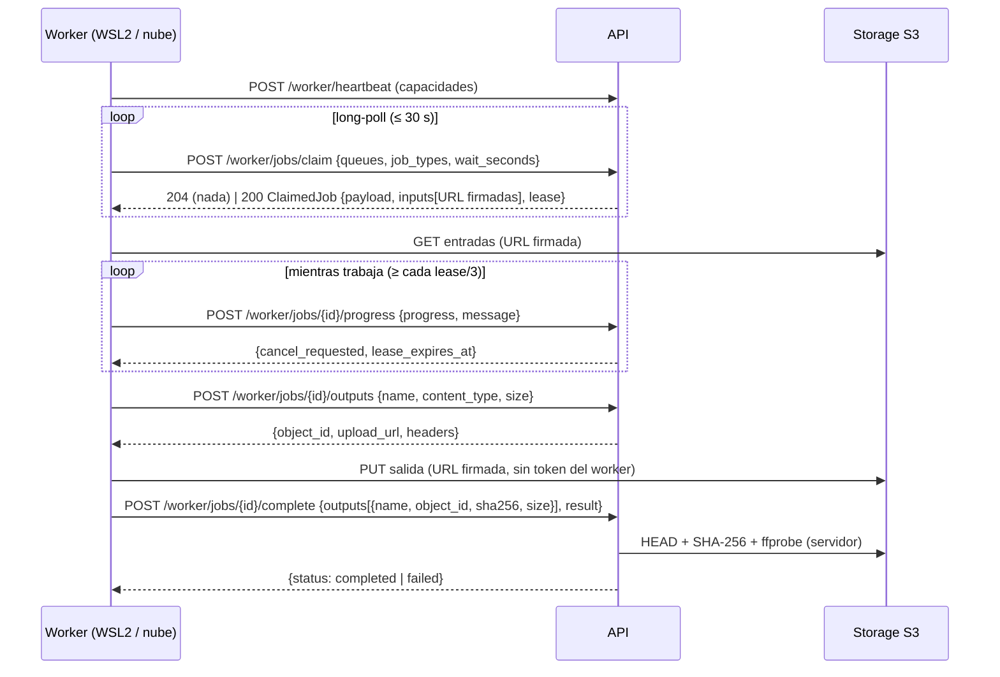

# Contratos

## 1. Convenciones de la API v1

- Prefijo `/api/v1`. Un cambio incompatible crea `/api/v2`; v1 se mantiene mientras haya
  clientes.
- OpenAPI generado por FastAPI: `packages/shared/openapi/openapi.json` (versionado). Los
  tipos TypeScript (`packages/shared/ts/src/api.d.ts`) se generan de él y CI falla si no
  están al día (`pnpm --filter @deken/shared check-generated`). Documentación
  interactiva en desarrollo: `http://localhost:8000/api/docs`.
- JSON en `snake_case`; fechas ISO 8601 con zona; IDs UUID.
- Errores, siempre con la misma forma:

```json
{"error": {"code": "permission_denied", "message": "No tienes permiso para esta acción",
           "details": null, "request_id": "f3a1…"}}
```

| HTTP | `code` habituales |
|---|---|
| 401 | `not_authenticated`, `session_invalid`, `invalid_credentials` |
| 403 | `permission_denied`, `csrf_failed`, `origin_not_allowed`, `queue_not_allowed` |
| 404 | `not_found` |
| 409 | `conflict`, `email_taken`, `last_admin`, `lease_lost`, `job_finished`, `not_available` |
| 413 | `payload_too_large`, `output_too_large` |
| 422 | `validation_error`, `weak_password`, `invalid_payload`, `unexpected_output`, `unsupported_content_type` |
| 429 | `rate_limited` (con `Retry-After`) |

- Cada respuesta lleva `X-Request-ID` (se acepta uno entrante válido) para correlacionar logs.

## 2. Autenticación

| Cliente | Mecanismo |
|---|---|
| Navegador | Cookie `deken_session` (HttpOnly, SameSite=Lax, Secure en producción). Métodos no seguros: cabecera `X-CSRF-Token` = valor de la cookie `deken_csrf` (HMAC de la sesión) y `Origin` permitido. |
| Worker | `Authorization: Bearer dkw_…` + `X-Deken-Job-Contract: 1`. Solo rutas `/api/v1/worker/*`. |

### Endpoints de Sprint 0

| Método y ruta | Permiso | Descripción |
|---|---|---|
| `GET /health/live` | público | El proceso responde |
| `GET /health/ready` | público | BD, Redis y storage; 503 si fallan BD o storage, `degraded` si solo Redis |
| `POST /auth/login` | público (limitado) | Inicia sesión |
| `POST /auth/logout` | sesión | Revoca la sesión |
| `GET /auth/me` | sesión | Usuario, permisos, caducidad, token CSRF |
| `POST /auth/password` | sesión | Cambia la contraseña (revoca otras sesiones) |
| `GET /system/status` | `system:read` | Estado detallado (servicios, workers, trabajos, IA) |
| `POST /system/selftest` | `system:manage` | Encola un autotest de render (señal sintética) |
| `GET /users/roles` | `system:read` | Matriz de roles |
| `GET/POST /users`, `PATCH /users/{id}`, `POST /users/{id}/password` | `users:manage` | Gestión de usuarios |
| `GET /workers` | `system:read` | Workers y si están en línea |
| `POST /workers`, `POST /workers/{id}/revoke` | `workers:manage` | Alta (token mostrado una vez) y revocación |
| `GET /jobs`, `GET /jobs/{id}` | `jobs:read` | Lista (filtros `status`, `type`, paginación `before`) y detalle con eventos y salidas |
| `POST /jobs/{id}/cancel`, `POST /jobs/{id}/retry` | `jobs:manage` | Cancelar / reintentar |
| `GET /files/{id}/download-url` | `files:read` | URL firmada (5 min) de un objeto verificado |
| `GET /audit` | `audit:read` | Eventos de auditoría |

## 3. Contrato de trabajos v1

Definido en código en `packages/shared/python/src/deken_shared/jobs.py` (fuente única,
importada por la API y por los workers).



Reglas:

1. **Reparto exclusivo**: `SELECT … FOR UPDATE SKIP LOCKED`; nunca dos workers con el
   mismo trabajo (probado con 6 claims concurrentes).
2. **Lease**: `job_lease_seconds` (120 s por defecto). Se renueva con cada `progress`. El
   *reaper* (cada 15 s) devuelve a la cola los leases vencidos (o los marca `failed` si
   no quedan intentos; `cancelled` si se había pedido cancelar).
3. **Reintentos**: `fail` con `retryable=true` o lease vencido ⇒ `queued` con `run_after =
   ahora + base·2^(intento-1)` (máx. 1 h) mientras `attempts < max_attempts`.
4. **Cancelación**: en cola ⇒ `cancelled` al instante; en curso ⇒ `cancel_requested`, el
   worker lo ve en el siguiente `progress`, mata FFmpeg y llama a `/cancelled`.
5. **Salidas**: solo nombres y tipos previstos por el tipo de trabajo; la clave en S3 la
   genera la API (`<prefijo>/<job>/<intento>/<uuid>.<ext>`).
6. **Completar = verificar**: existe, tamaño y SHA-256 coinciden y, si es vídeo, ffprobe en
   servidor cumple la `VideoSpec` (contenedor MP4, H.264, `yuv420p`, resolución, fps,
   número de fotogramas ±1, píxel cuadrado, AAC 48 kHz, duración de audio y contenedor).
   Si no, `failed` con `output_verification_failed` y el objeto queda `rejected`.
7. **Lease perdido**: cualquier llamada de un worker que ya no es dueño ⇒ 409 `lease_lost`;
   el worker abandona el trabajo.
8. **Versión**: `X-Deken-Job-Contract` distinto de `1` ⇒ 400.

### Tipos de trabajo

| Tipo | Cola | Payload | Salidas | Sprint |
|---|---|---|---|---|
| `system.render_selftest` | render | `duration_s` (1–30), `width`, `height`, `fps`, `label` | `video` (`video/mp4`, verificado) | 0 |
| `media.probe` | analysis | `asset_id` | `probe` (`application/json`) | 1 |
| `media.derive` | analysis | `asset_id`, derivados pedidos | `poster`, `strip`, `proxy` | 1 |
| `media.segments` | analysis | `asset_id`, detectores | `segments` (JSON), `transcript` (VTT) | 3 |
| `render.timeline` | render | `timeline_version_id`, `VideoSpec` | `video` | 3 |

## 4. Línea de tiempo v1 (borrador para Sprint 3)

Documento JSON inmutable por versión (`timeline_versions.document`). Las posiciones se
expresan en **fotogramas** a la tasa de la salida (30 fps) para evitar errores de
redondeo; los recortes de origen, en segundos del original.

```json
{
  "schema": "deken.timeline/1",
  "output": {"width": 1080, "height": 1920, "fps": 30, "duration_frames": 900},
  "tracks": [
    {"id": "v1", "kind": "video", "clips": [
      {"id": "c1", "asset_id": "…", "segment_id": "…",
       "source_in_s": 12.4, "source_out_s": 16.4, "at_frame": 0,
       "reframe": {"x": 0.21, "y": 0.0, "w": 0.5625, "h": 1.0},
       "speed": 1.0, "volume": 0.0, "fade_in_frames": 0, "fade_out_frames": 6}
    ]},
    {"id": "t1", "kind": "text", "clips": [
      {"id": "x1", "text": "…", "at_frame": 15, "duration_frames": 75,
       "style": "headline", "safe_area": "top", "fact_ids": ["…"]}
    ]},
    {"id": "s1", "kind": "subtitles", "source": "transcript", "style": "caption"},
    {"id": "a1", "kind": "audio", "clips": [
      {"id": "m1", "brand_asset_id": "…", "license_ref": "…", "at_frame": 0,
       "duration_frames": 900, "volume": 0.4}
    ]}
  ]
}
```

Reglas de validación previstas: `reframe` normalizado (0–1) y con la relación de aspecto
de la salida (sin deformar); clips sin solaparse en la misma pista; cada clip de vídeo
referencia un segmento existente (sin escenas inventadas); textos ≥ 30 px a 1080×1920 y
dentro de zona segura; música solo con `license_ref`.
