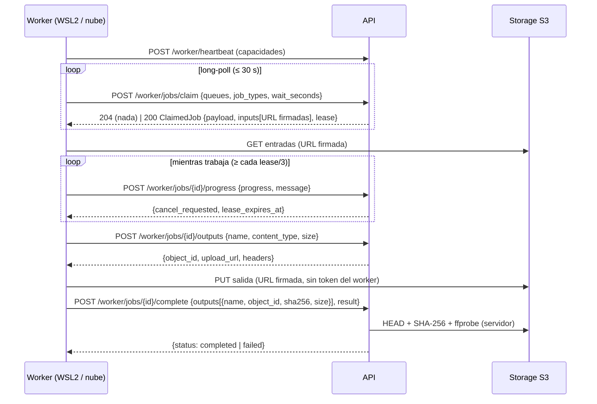

# Contratos

## 1. Convenciones de la API v1

- Prefijo `/api/v1`. Un cambio incompatible crea `/api/v2`; v1 se mantiene mientras haya
  clientes.
- OpenAPI generado por FastAPI: `packages/shared/openapi/openapi.json` (versionado). Los
  tipos TypeScript (`packages/shared/ts/src/api.d.ts`) se generan de él y CI falla si no
  están al día (`pnpm --filter @deken/shared check-generated`). Documentación
  interactiva en desarrollo: `http://localhost:8000/api/docs`.
- JSON en `snake_case`; fechas ISO 8601 con zona; IDs UUID.
- Errores, siempre con la misma forma:

```json
{"error": {"code": "permission_denied", "message": "No tienes permiso para esta acción",
           "details": null, "request_id": "f3a1…"}}
```

| HTTP | `code` habituales |
|---|---|
| 401 | `not_authenticated`, `session_invalid`, `invalid_credentials` |
| 403 | `permission_denied`, `csrf_failed`, `origin_not_allowed`, `queue_not_allowed` |
| 404 | `not_found` |
| 409 | `conflict`, `email_taken`, `last_admin`, `lease_lost`, `job_finished`, `not_available`, `upload_incomplete`, `upload_closed`, `remotion_license_required`, `input_unavailable` |
| 413 | `payload_too_large`, `output_too_large`, `file_too_large` |
| 422 | `validation_error`, `weak_password`, `invalid_payload`, `unexpected_output`, `unsupported_content_type`, `unsupported_format`, `invalid_tag`, `consent_reference_required`, `invalid_timeline`, `unauthorized_media` |
| 429 | `rate_limited` (con `Retry-After`) |

- Cada respuesta lleva `X-Request-ID` (se acepta uno entrante válido) para correlacionar logs.

## 2. Autenticación

| Cliente | Mecanismo |
|---|---|
| Navegador | Cookie `deken_session` (HttpOnly, SameSite=Lax, Secure en producción). Métodos no seguros: cabecera `X-CSRF-Token` = valor de la cookie `deken_csrf` (HMAC de la sesión) y `Origin` permitido. |
| Worker | `Authorization: Bearer dkw_…` + `X-Deken-Job-Contract: 1`. Solo rutas `/api/v1/worker/*`. |

### Endpoints de Sprint 0

| Método y ruta | Permiso | Descripción |
|---|---|---|
| `GET /health/live` | público | El proceso responde |
| `GET /health/ready` | público | BD, Redis y storage; 503 si fallan BD o storage, `degraded` si solo Redis |
| `POST /auth/login` | público (limitado) | Inicia sesión |
| `POST /auth/logout` | sesión | Revoca la sesión |
| `GET /auth/me` | sesión | Usuario, permisos, caducidad, token CSRF |
| `POST /auth/password` | sesión | Cambia la contraseña (revoca otras sesiones) |
| `GET /system/status` | `system:read` | Estado detallado (servicios, workers, trabajos, IA) |
| `POST /system/selftest` | `system:manage` | Encola un autotest de render (señal sintética) |
| `GET /users/roles` | `system:read` | Matriz de roles |
| `GET/POST /users`, `PATCH /users/{id}`, `POST /users/{id}/password` | `users:manage` | Gestión de usuarios |
| `GET /workers` | `system:read` | Workers y si están en línea |
| `POST /workers`, `POST /workers/{id}/revoke` | `workers:manage` | Alta (token mostrado una vez) y revocación |
| `GET /jobs`, `GET /jobs/{id}` | `jobs:read` | Lista (filtros `status`, `type`, paginación `before`) y detalle con eventos y salidas |
| `POST /jobs/{id}/cancel`, `POST /jobs/{id}/retry` | `jobs:manage` | Cancelar / reintentar |
| `GET /files/{id}/download-url` | `files:read` | URL firmada (5 min) de un objeto verificado |
| `GET /audit` | `audit:read` | Eventos de auditoría |

### Endpoints de Sprint 1

| Método y ruta | Permiso | Descripción |
|---|---|---|
| `POST /media/uploads` | `media:write` | Crea la subida multiparte (MP4/MOV, ≤ 20 GiB) → `asset_id`, tamaño de parte (16 MiB), nº de partes |
| `POST /media/uploads/{id}/parts` | `media:write` | URLs firmadas `PUT` para un lote de partes (≤ 50 por petición) |
| `POST /media/uploads/{id}/complete` | `media:write` | `ListParts` en servidor (409 `upload_incomplete` si falta alguna), cierre, ffprobe → `processing` + ingesta, o `rejected` (el objeto se borra) |
| `POST /media/uploads/{id}/abort` | `media:write` | Aborta la subida en el almacenamiento → `cancelled` |
| `GET /media/assets` | `media:read` | Galería: `q`, `tag` (varias), `status`, `orientation`, `has_audio`, `consent`, `include_archived`, `limit`/`offset`; URLs firmadas de póster y tira |
| `GET /media/tags` | `media:read` | Etiquetas con recuento |
| `GET /media/assets/{id}` | `media:read` | Ficha: metadatos, derivados verificados, URL del proxy |
| `GET /media/assets/{id}/waveform` | `media:read` | Picos de audio (`{version, duration_s, peaks}`) |
| `GET /media/assets/{id}/original-url` | `media:read` | URL firmada del original (auditada) |
| `PATCH /media/assets/{id}` | `media:write` | Título, descripción, etiquetas, fecha y lugar |
| `PUT /media/assets/{id}/rights` | `media:rights` | Personas, consentimiento (+ referencia), restricciones, titular; auditoría con diff |
| `POST /media/assets/{id}/archive` | `media:write` | Archiva (el original se conserva) |
| `POST /brand/uploads` | `brand:manage` | Logo (PNG/WebP), tipografía (TTF/OTF) o imagen → URL `PUT` firmada |
| `POST /brand/uploads/{id}/complete` | `brand:manage` | Análisis real (proporción, familia, tinta, transparencia, fondo; fontTools) |
| `GET /brand/assets`, `GET /brand/assets/{id}` | `brand:read` | Recursos listos, con vista previa |
| `PATCH /brand/assets/{id}`, `POST /brand/assets/{id}/archive` | `brand:manage` | Fondo de uso, familia, color declarado, notas, licencia |
| `GET /brand/assets/{id}/download-url` | `brand:read` | URL firmada del fichero oficial |
| `GET /renders/engine` | `system:read` | Modo de licencia de Remotion, renders comerciales sí/no, workers con Remotion |
| `POST /renders/evaluation` | `system:manage` | Encola la prueba técnica de Remotion (5 s, 1080×1920, 30 fps) |
| `POST /renders/timeline` | `render:create` | Render de una línea de tiempo: esquema (422 `invalid_timeline`), medios autorizados (422 `unauthorized_media`), `purpose=production` solo con licencia de empresa (409 `remotion_license_required`) |

## 3. Contrato de trabajos v1

Definido en código en `packages/shared/python/src/deken_shared/jobs.py` (fuente única,
importada por la API y por los workers).



Reglas:

1. **Reparto exclusivo**: `SELECT … FOR UPDATE SKIP LOCKED`; nunca dos workers con el
   mismo trabajo (probado con 6 claims concurrentes).
2. **Lease**: `job_lease_seconds` (120 s por defecto). Se renueva con cada `progress`. El
   *reaper* (cada 15 s) devuelve a la cola los leases vencidos (o los marca `failed` si
   no quedan intentos; `cancelled` si se había pedido cancelar).
3. **Reintentos**: `fail` con `retryable=true` o lease vencido ⇒ `queued` con `run_after =
   ahora + base·2^(intento-1)` (máx. 1 h) mientras `attempts < max_attempts`.
4. **Cancelación**: en cola ⇒ `cancelled` al instante; en curso ⇒ `cancel_requested`, el
   worker lo ve en el siguiente `progress`, mata FFmpeg y llama a `/cancelled`.
5. **Salidas**: solo nombres y tipos previstos por el tipo de trabajo; la clave en S3 la
   genera la API (`<prefijo>/<job>/<intento>/<uuid>.<ext>`).
6. **Completar = verificar**: existe, tamaño y SHA-256 coinciden y, si es vídeo, ffprobe en
   servidor cumple la `VideoSpec` (contenedor MP4, H.264, `yuv420p`, resolución, fps
   —admite cadencias fraccionarias ±0,02—, número de fotogramas con la tolerancia del
   tipo, píxel cuadrado, AAC 48 kHz, duración de audio y contenedor); si es imagen,
   formato y tamaño máximo (`ImageSpec`); si es JSON, objeto válido ≤ 2 MB. Las salidas
   pueden ser obligatorias u opcionales. Si algo falla, `failed` con
   `output_verification_failed` y el objeto queda `rejected`.
9. **Entradas**: el payload declara `inputs` (objetos ya verificados); el `claim` los
   entrega con URL firmada de lectura y metadatos (`kind`, `extension`, `key`, tamaño,
   SHA-256). El worker comprueba tamaño y SHA-256 al descargar.
10. **Prefijo según el tipo**: `storage_kind_for(payload)`; p. ej. un render de
    evaluación va a `evaluation/` y uno de producción a `renders/`.
11. **Capacidades**: el heartbeat declara `job_types` (solo los que el worker puede
    ejecutar: los de Remotion solo si el motor está disponible) y `engines`
    (versiones de Remotion, Node y modo de licencia).
7. **Lease perdido**: cualquier llamada de un worker que ya no es dueño ⇒ 409 `lease_lost`;
   el worker abandona el trabajo.
8. **Versión**: `X-Deken-Job-Contract` distinto de `1` ⇒ 400.

### Tipos de trabajo

| Tipo | Cola | Payload | Salidas | Sprint |
|---|---|---|---|---|
| `system.render_selftest` | render | `duration_s` (1–30), `width`, `height`, `fps`, `label` | `video` (`video/mp4`, verificado) | 0 |
| `media.ingest` | analysis | `asset_id`, `inputs` (original), `proxy` (tamaño, fps, duración, audio), parámetros de póster/tira/forma de onda | `poster`, `strip` (JPEG), `proxy` (MP4 verificado), `waveform` (JSON, opcional); `result.sha256` del original | 1 |
| `system.remotion_eval` | render | `title`, `subtitle`, `label` | `video` (1080×1920, 30 fps, 150 fotogramas exactos) en `evaluation/` | 1 |
| `render.timeline` | render | `timeline` (`deken.timeline/1`), `purpose` (`evaluation`/`production`), `inputs` resueltos, `title` | `video` según `timeline.output`, fotogramas exactos; `evaluation/` o `renders/` | 1 (motor) / 3 (proyectos) |
| `media.segments` | analysis | `asset_id`, detectores | `segments` (JSON), `transcript` (VTT) | 3 |

Códigos de error de handlers añadidos en Sprint 1: `invalid_media` (no reintentable:
el original no se decodifica), `invalid_timeline`, `remotion_license_required`,
`render_failed`, `engine_unavailable` (reintentable).

## 4. Línea de tiempo `deken.timeline/1` (implementada en Sprint 1)

Fuente única: `packages/video-compositions/src/schema/timeline.ts` (zod). De ella se
genera el JSON Schema (`packages/video-compositions/schema/timeline.schema.json`, copiado
a `deken_shared/schemas/` para la API); CI falla si no está al día (`check-schema`).
La API valida la **estructura** con ese JSON Schema; las **reglas semánticas**
(`validate.ts`) las aplica el renderer antes de renderizar y las aplicará el editor
(Sprint 4). Previsualización (Remotion Player) y render usan el mismo documento.

Posiciones y duraciones en **fotogramas** a la tasa de salida; recortes de origen en
**segundos** del original. Los medios se referencian por ID (`asset_id`,
`brand_asset_id`); las URLs se resuelven en cada render y no se guardan.

```json
{
  "schema": "deken.timeline/1",
  "template": "reel_vertical",
  "output": {"format": "vertical_9_16", "width": 1080, "height": 1920, "fps": 30,
             "duration_frames": 450},
  "tracks": [
    {"id": "video", "kind": "video", "clips": [
      {"id": "c1", "asset_id": "…", "source_in_s": 12.4, "source_out_s": 16.4,
       "at_frame": 0, "speed": 1, "fit": "cover",
       "reframe": {"x": 0.342, "y": 0, "w": 0.3164, "h": 1},
       "volume": 0, "fade_out_frames": 6,
       "transition_in": {"type": "cut", "frames": 0}}
    ]},
    {"id": "textos", "kind": "text", "clips": [
      {"id": "t1", "text": "…", "at_frame": 15, "duration_frames": 90,
       "style": "headline", "size_px": 96, "position": "top", "box": true,
       "fact_ids": ["…"]}
    ]},
    {"id": "subs", "kind": "subtitles", "size_px": 48,
     "cues": [{"start_frame": 0, "end_frame": 60, "text": "…"}]},
    {"id": "marca", "kind": "brand", "clips": [
      {"id": "l1", "brand_asset_id": "…", "at_frame": 360, "duration_frames": 90,
       "corner": "bottom_right", "width_px": 320}
    ]},
    {"id": "musica", "kind": "audio", "role": "music", "clips": [
      {"id": "m1", "brand_asset_id": "…", "license_ref": "…", "at_frame": 0,
       "duration_frames": 450, "volume": 0.4}
    ]}
  ]
}
```

| Regla | Dónde |
|---|---|
| Formato con tamaño fijo (9:16 = 1080×1920, 16:9 = 1920×1080, 1:1 = 1080×1080); 24/25/30/60 fps; ≤ 10 min | JSON Schema (API) + zod |
| Reencuadre normalizado dentro de la imagen | JSON Schema + zod |
| Reencuadre con la proporción de la salida (±1 %): nunca se deforma | `validate.ts` (con las dimensiones reales del original) |
| Clips dentro de la duración; vídeo sin solapes salvo durante la transición de entrada | `validate.ts` |
| Texto ≥ 30 px y visible ≥ 2,5 s; subtítulos dentro de la duración | JSON Schema (tamaño) + `validate.ts` |
| Logo nunca en los 3 primeros segundos | `validate.ts` |
| Música con `license_ref` | `validate.ts` |
| Medios existentes, `ready`, no archivados; producción solo con derechos de imagen | API (`unauthorized_media`) |
| `source_out_s` dentro de la duración del original | `validate.ts` |
