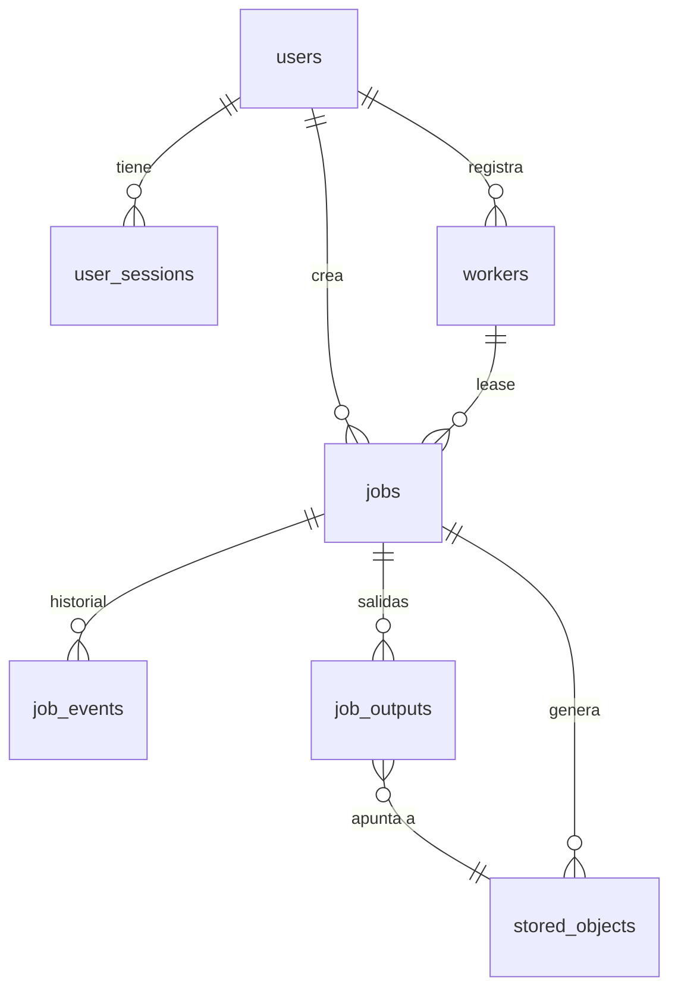
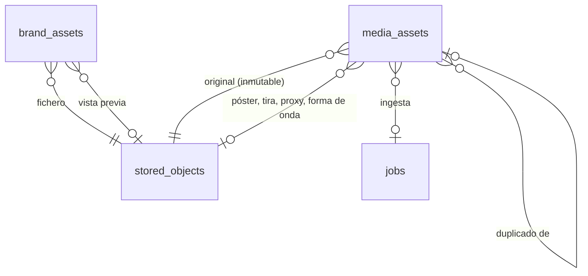

# Modelo de datos

PostgreSQL 16 es la fuente de verdad. Migraciones Alembic en `infra/migrations/`
(versionadas, reversibles, comprobadas sin deriva en `test_migrations.py`).

Convenciones: claves primarias UUID v4 (salvo tablas de eventos, `BIGINT IDENTITY`),
fechas `timestamptz` en UTC, enumeraciones como `VARCHAR` + `CHECK` (migraciones simples),
JSON en `JSONB`, nombres de restricciones deterministas (`pk_`, `fk_`, `uq_`, `ck_`, `ix_`).

## 1. Implementado en Sprint 0 (migración `0001`)

### `users`
| Columna | Tipo | Notas |
|---|---|---|
| id | uuid PK | |
| email | varchar(320) único | siempre en minúsculas (`CHECK`) |
| full_name | varchar(200) | |
| password_hash | varchar(255) | argon2id |
| role | varchar(16) | `admin` · `editor` · `reviewer` · `viewer` |
| is_active | bool | desactivar revoca sus sesiones al instante |
| created_at / updated_at / last_login_at / password_changed_at | timestamptz | |

### `user_sessions`
Sesiones de servidor. La cookie lleva un token aleatorio de 256 bits; aquí solo se guarda
su SHA-256 (`token_hash`, único). Caducidad absoluta (`expires_at`, 7 días por defecto) y
por inactividad (`last_seen_at`, 12 h). `revoked_at` + `revoked_reason` (`logout`,
`password_changed`, `user_deactivated`, `password_reset_by_admin`).

### `audit_events` (solo inserción)
`id`, `occurred_at`, `actor_type` (`user|worker|system|anonymous`), `actor_id`,
`actor_label`, `action` (p. ej. `auth.login`, `user.role_change`, `worker.register`,
`job.cancel`, `file.download_url`, `authz.denied`), `outcome`
(`success|failure|denied`), `target_type`, `target_id`, `ip`, `user_agent`,
`request_id`, `details` JSONB. Un *trigger* impide `UPDATE` y `DELETE`.

### `workers`
`name` único, `token_prefix` (para identificarlo en la interfaz), `token_hash` (SHA-256),
`status` (`active|revoked`), `queues` (array), `capabilities` JSONB (versiones de
FFmpeg, codificadores, aceleración por hardware, tipos de trabajo), `version`,
`hostname`, `platform`, `last_seen_at`, `created_by_user_id`, `revoked_at`.

### `jobs`
| Columna | Notas |
|---|---|
| type, queue | p. ej. `system.render_selftest` en `render` |
| status | `queued` · `processing` · `completed` · `failed` · `cancelled` |
| priority | mayor primero |
| payload | validado por el modelo Pydantic del tipo (contrato compartido) |
| result / error | JSONB; `error` = `{code, message, retryable, details, attempt}` |
| progress, progress_message | 0..1 (`CHECK`) |
| attempts, max_attempts | reintentos con backoff exponencial |
| run_after | no se reclama antes (backoff) |
| lease_owner_id, lease_expires_at | propiedad temporal del worker |
| cancel_requested | cancelación cooperativa |
| timeout_s, contract_version | |
| created_by_user_id, created_at, updated_at, started_at, finished_at | |

Índices parciales: `ix_jobs_claimable (queue, priority, created_at) WHERE status='queued'`
y `ix_jobs_lease (lease_expires_at) WHERE status='processing'`.

### `job_events`
Historial por trabajo: `created`, `claimed`, `progress` (solo cambios de mensaje),
`output_registered`, `retry_scheduled`, `lease_expired`, `cancel_requested`,
`cancelled`, `verification_failed`, `failed`, `completed`, `manual_retry`.

### `stored_objects`
Objeto en S3: `bucket` + `key` (únicos, **generados por el servidor**), `kind`
(`original|derived|render|brand|system_test|evaluation` — `evaluation` desde la
migración `0002`, renders de evaluación de Remotion), `status`
(`pending|available|rejected|deleted`), `content_type`, `size_bytes`, `sha256`,
`original_filename` (saneado, solo metadato), `media_info` (resumen ffprobe),
`verified_at`, `created_by_user_id`, `created_by_job_id`. Solo los `available` se pueden
descargar.

### `job_outputs`
Una fila por salida declarada y por intento (`job_id`, `attempt`, `name` únicos),
con `object_id`, `kind`, `verified` y `verification` (problemas detectados).

## 2. Implementado en Sprint 1 (migración `0002`)

### `media_assets` (biblioteca audiovisual)
| Grupo | Columnas | Notas |
|---|---|---|
| Estado | `status` | `uploading` → `processing` → `ready` · `rejected` (no es vídeo / corrupto) · `failed` (error de proceso, reintentable) · `duplicate` · `cancelled` (subida abortada); `status_reason` |
| Subida | `original_object_id`, `upload_id`, `part_size_bytes`, `part_count`, `declared_size_bytes`, `original_filename` | multiparte S3; el `upload_id` solo vive mientras dura la subida |
| Integridad | `sha256` (índice), `duplicate_of_id` | el hash lo calcula la ingesta; mismo hash que un activo `ready` → `duplicate` |
| Técnicos (ffprobe) | `container`, `duration_s`, `width`, `height` (**de visualización**: rotación y SAR aplicadas), `rotation`, `fps`, `video_codec`, `audio_codec`, `has_audio`, `bit_rate`, `probe` (JSONB) | validados en la API al cerrar la subida |
| Derivados | `poster_object_id`, `strip_object_id`, `strip_frames`, `proxy_object_id`, `waveform_object_id`, `ingest_job_id` | solo salidas verificadas en servidor |
| Catálogo | `title`, `description`, `tags` (array, índice GIN, normalizadas en minúsculas), `recorded_at`, `location` | |
| Derechos de imagen | `people_present` (`yes`/`no`/`unknown`), `consent_status` (`not_required`/`pending`/`granted`/`denied`), `consent_reference` (obligatoria si `granted`), `usage_restrictions`, `rights_owner` (por defecto "Grupo Deken"), `rights_updated_at`, `rights_updated_by_user_id` | uso en producción solo si `people_present = no` o consentimiento `granted`/`not_required` |
| Registro | `created_by_user_id`, `created_at`, `updated_at`, `archived_at` | archivar oculta el activo; el original se conserva |

### `brand_assets` (marca DEKEN)
| Grupo | Columnas | Notas |
|---|---|---|
| Identidad | `kind` (`logo`/`font`/`image`), `name`, `family` (`DEKEN`, `GD`, `GRUPO-DEKEN`, `GRUPO-DEKEN-HORIZONTAL`), `status` (`uploading`/`ready`/`rejected`/`cancelled`) | la familia se deduce de la proporción (±12 %) si no se indica |
| Fichero | `object_id`, `preview_object_id`, `original_filename`, `content_type`, `declared_size_bytes`, `sha256` | logos solo PNG/WebP; tipografías TTF/OTF |
| Análisis del logo | `width`, `height`, `aspect_ratio`, `has_alpha`, `declared_color` (del nombre), `measured_color_name`, `measured_color_hex`, `color_mismatch`, `recommended_background`, `usage_background` (`dark`/`light`/`any`), `analysis` (JSONB: proporción de tintas, avisos) | la tinta se mide en los píxeles opacos; el nombre del fichero no se da por bueno |
| Tipografía | `font_family`, `font_style`, `font_weight` | cursiva detectada → aviso (prohibida por la guía) |
| Otros | `license_ref`, `notes`, `created_by_user_id`, `archived_at` | |

## 3. Evolución prevista (se añadirá con migraciones nuevas)

| Sprint | Tablas | Campos clave |
|---|---|---|
| 3/4 | `brand_assets` (`kind = music`) | `license_ref` obligatorio para música |
| 2 | `knowledge_sources` | `title`, `kind` (`document`, `url`, `note`), `object_id`/`url`, `owner_user_id`, `verified_at`, `verified_by` |
| 2 | `knowledge_facts` | `source_id`, `statement`, `status` (`proposed`/`approved`/`retired`), `approved_by` |
| 2 | `campaigns` | `name`, `objective`, `audience`, `starts_on`, `ends_on`, `status` |
| 2 | `content_items` | `campaign_id`, `objective`, `audience`, `platform`, `format`, `duration_s`, `key_message`, `cta`, `approval_status` (`draft`→`in_review`→`approved`/`changes_requested`), `scheduled_for` |
| 2 | `scripts`, `storyboard_shots` | guion versionado; planos temporizados con `fact_ids` citados |
| 2 | `approvals` | `content_id`, `decision`, `reviewer_id`, `comment` |
| 3 | `media_segments` | `asset_id`, `start_s`, `end_s`, `kind` (`scene`, `speech`, `silence`, `black`, `blur`), `score`, `labels`, `transcript` |
| 3 | `projects` | `title`, `content_id`, `aspect`, `target_duration_s` |
| 3 | `timeline_versions` | `project_id`, `version`, `document` (JSON `deken.timeline/1`, validado con el JSON Schema generado), `created_by`; inmutables |
| 3 | `renders` | `timeline_version_id`, `job_id`, `output_object_id` |
| V2 | `social_accounts`, `publications`, `metrics`, `leads` | OAuth oficial; datos personales de leads con base legal y retención |
